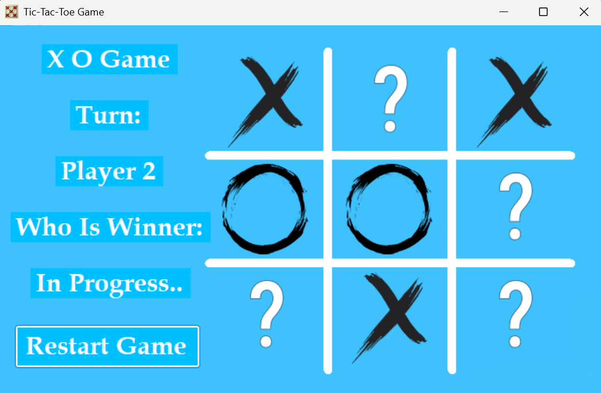
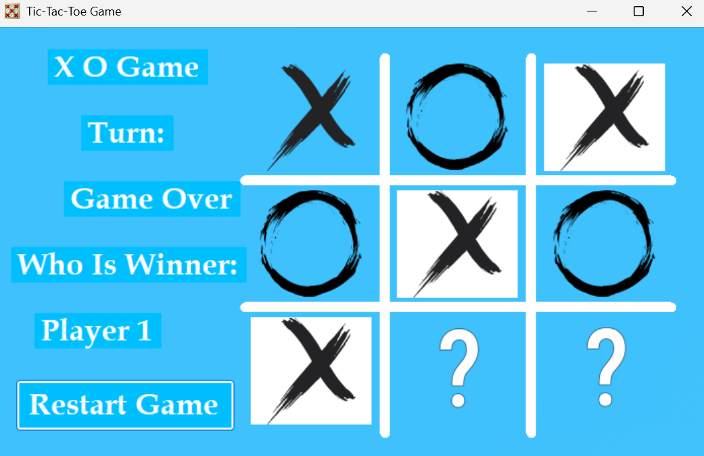

# ❌ Tic-Tac-Toe Game (C# Windows Forms)

A classic **Tic-Tac-Toe (X-O)** game built using **C#** and **Windows Forms**, developed as a desktop application project with a clean interface, smooth game loop, and robust win-checking logic.

---

## 🎮 Features
* **Two-Player Mode:** Play locally with a friend (Player 1 as **X** and Player 2 as **O**).
* **Turn Indicator:** Dynamic UI updates tracking whose turn it is in real-time.
* **Win Detection Algorithm:** Automatically checks all 8 possible winning conditions (Rows, Columns, and Diagonals) to instantly declare the winner.
* **Game Over State:** Disables the game board once a player wins to prevent further moves.
* **Restart Functionality:** Reset button to clear the board and start a new match instantly.

---

## 📸 Screenshots

| Game In Progress (أثناء اللعب) | Game Over / Winner (لحظة الفوز) |
| :---: | :---: |
|  |  |

---

## 🛠️ Built With
* **Language:** C#
* **Framework:** .NET / Windows Forms (.NET Framework or .NET Core)
* **IDE:** Visual Studio

---

## ⚙️ How to Run
1. Clone the repository:
   git clone [https://github.com/Yahya-Alrabayah/Tic-Tac-Toe-CSharp.git](https://github.com/Yahya-Alrabayah/Tic-Tac-Toe-CSharp.git)
2. Open the solution file (.sln) using Visual Studio.

3. Build and Run the project (F5 or click the Start button).

👤 Author
* Yahya Alrabayah

* GitHub: @Yahya-Alrabayah
